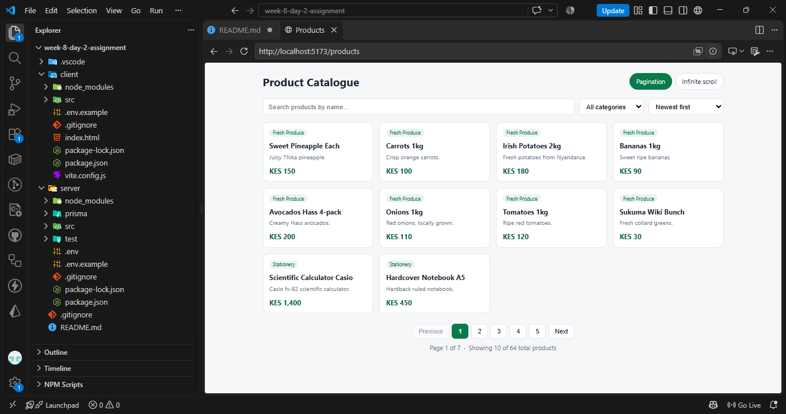
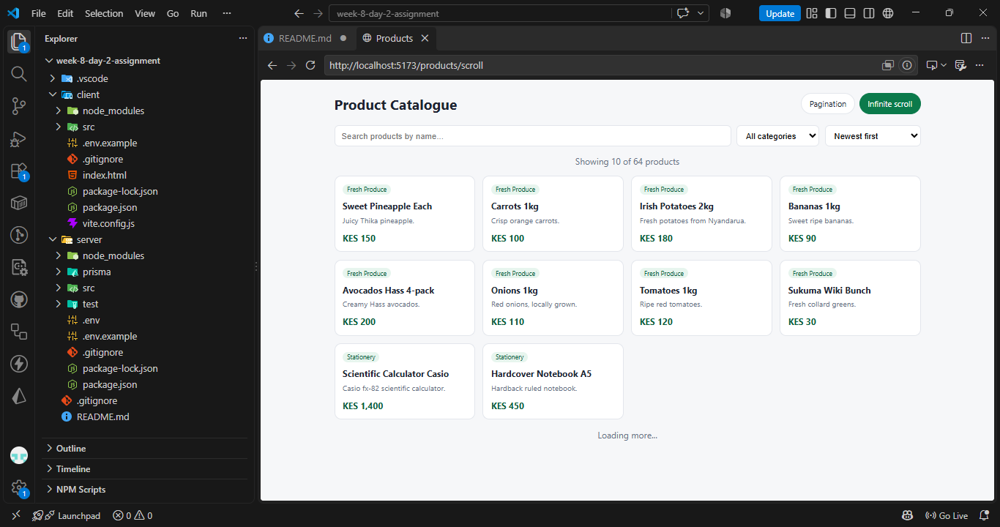

# Week 8 Day 2 — Pagination, Infinite Scroll, Sort & Filter

Express + Prisma (PostgreSQL) API and a Vite React client.

## Screenshots





## Run it

```bash
# 1. Server
cd server
npm install
cp .env.example .env          # set DATABASE_URL to your Postgres database
npx prisma migrate dev --name init
npx prisma db seed            # seeds 64 products across 8 categories (KES)
npm run dev                   # http://localhost:5000

# 2. Client (new terminal)
cd client
npm install
cp .env.example .env
npm run dev                   # http://localhost:5173
```

Routes: `/products` (numbered pagination) and `/products/scroll` (infinite scroll).
Both pages share the search box, category filter and sort dropdown.

## API

`GET /api/products?page=1&limit=10&sort=price&order=asc&category=Beverages&search=tea`

| Param | Rules |
|---|---|
| page | integer >= 1 (default 1) |
| limit | integer 1–100 (default 10) |
| sort | `createdAt` (default), `price`, `name` |
| order | `asc` or `desc` (default `desc`) |
| category | exact match |
| search | case-insensitive name contains |

Invalid values return `400 { error }`. A page past the end returns `200` with an empty `data` array and correct `metadata`.
`GET /api/categories` returns the distinct categories for the dropdown.

```bash
curl "http://localhost:5000/api/products"
curl "http://localhost:5000/api/products?page=2&limit=5"
curl "http://localhost:5000/api/products?page=100&limit=10"
curl "http://localhost:5000/api/products?sort=price&order=asc&category=Beverages&search=tea"
```

## Tests

```bash
cd server && npm test   # API contract tests (in-memory Prisma stand-in, no DB needed)
cd client && npm test   # component tests (pagination, infinite scroll, filters)
```
